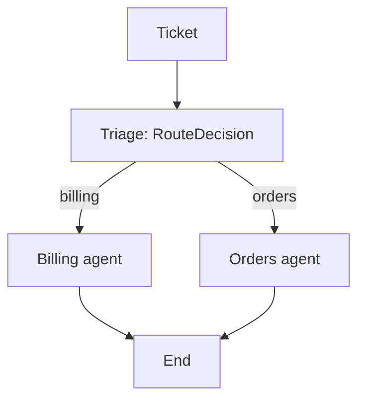

# Stage 2: supervisor and scoped specialists

`build_supervisor_graph()` in `src/merchant_triage/specialists.py` compiles:



## Pydantic decision and actual bindings

`RouteDecision` is a strict Pydantic `BaseModel` with
`route: Literal["billing", "orders"]`, a nonempty `reason`, and required finite
`confidence: float` between 0 and 1. `Decision`
remains an alias for stage-1 compatibility. Triage returns this model in
`state["decision"]`; the conditional edge uses its validated `.route`.
Here “route decision” means named fields, rather than a scalar `RootModel`.

Each `SpecialistAgent` constructs its own tuple with `bind_tools(role)`.
Only that tuple's schemas are sent to its model. Its executable `ToolSession`
also rejects every unbound name. Triage receives no admin tools. Fixture
access, `reset_store()` and call-log inspection are host/evaluator-only.

| Agent | Read tools | Write tools |
| --- | --- | --- |
| Both | `get_shop` | — |
| Billing | `get_app_subscriptions`, `list_billing_charges` | `cancel_app_subscription`, `issue_billing_credit` |
| Orders | `get_order`, `list_orders`, `list_order_transactions`, `calculate_refund`, `get_delivery_profile` | `create_refund`, `update_shipping_rate`, `recalculate_order_shipping`, `update_order_shipping_address`, `cancel_order`, `add_order_note` |

Effects are tool metadata, model-visible descriptions and trace fields.
`calculate_refund` is read-only; `create_refund` writes a customer-order refund.
All 16 supplied admin functions are accounted for. The supplied mock Python
file is preserved without edits as `src/merchant_triage/mock_admin.py`.
These calls operate an in-memory mock; no real Shopify API is called.

## Fixture mismatch and honest scope

| Source | Maria | Domain | Issue |
| --- | --- | --- | --- |
| Original CSV `SUP-48213` | Maria Sousa | `barro-azul-ceramica.myshopify.com` | Portugal/Europe checkout rates swapped |
| Supplied mock store | Maria Santos | `azulejo-ceramica-lisboa.myshopify.com` | EU Standard EUR 0; domestic EUR 4.90 |

None of the 24 CSV domains exists among the four mock fixtures. The supervisor
can load all 24, but cannot fix their absent stores. It keeps the original
domain, calls `get_shop`, reports missing fixture data and leaves stores
unchanged. No identity remapping or invented fixture is used. CSV expected
fixes/tool names are evaluator-only; absent API names such as
`get_shipping_profile` are not invented as executable tools.

`data/supervisor_demo_tickets.json` contains two explicitly authored fixture
integration cases, separate from the original 24:

- **Maria Santos:** verify the profile and historical order `#1158`, restore
  `rate_eu_standard` from EUR 0 to EUR 14.90 for future checkouts, list all 40
  zero-postage EU Standard orders from 29 Nov through 2 Dec, preserve domestic
  shipping and leave existing orders unchanged. This does not stand in for
  Maria Sousa's different expected fix.
- **Owen Brooks:** read app subscriptions and November invoice lines, credit
  exactly one duplicate USD 19.99 ReviewStream charge, preserve the active app
  subscription and leave customer orders unchanged.

## Per-call evidence

Every ticket starts with `reset_store()`. Execution validates strict argument
schemas and the ticket's store boundary, requires `get_shop` first and requires
write-target IDs to have appeared in prior reads. Each call records arguments,
effect, result, the actual `CALL_LOG`, pre/post store SHA-256 and changed paths.
Independent code compares read results to pre-call data and write results and
effects to post-call data, checking unrelated fields as well. Each fixture demo
also has explicit end-state assertions outside the model (`verify_demo`).

These are simulated integration boundaries, not a complete production payments
policy. Approval thresholds, persistent idempotency, human escalation and
mixed-issue resolution remain later work. A single selected specialist does
not solve both halves of a mixed ticket. Runs stop after 10 model turns or 24
tool calls. Prior successful writes remain visible if a later step errors.

## Commands and workflow

```bash
python -m pytest -q
merchant-triage supervise data/supervisor_demo_tickets.json --output reports/supervisor-smoke.json
merchant-triage supervise data/source/shopify_merchant_tickets.csv \
  --ticket-id SUP-48213 --ticket-id SUP-48197 --output reports/supervisor-original.json
# The graph can also iterate the full original set; its fixtures are missing:
merchant-triage supervise data/source/shopify_merchant_tickets.csv --output reports/supervisor-24.json
```

The CLI prints merchant names, routes/reasons, agents, READ/WRITE calls and
store-check outcomes. JSON includes the full actual results and call log.
Exit codes: `0` all cases passed, `1` includes failed/unavailable cases, `2`
configuration/input error. The mock store is reset after reporting.

The manual **Supervisor mock-store smoke** workflow uses the existing Actions
secret and pinned free model. It requires the two fixture-backed passes and
separately checks that two original tickets report missing stores without a
write. Workflow success does not mean those original expected fixes succeeded.
Offline tests use scripted model replies and do not measure classification.

The triage prompt is `SYSTEM_PROMPT` in `openrouter.py`. The specialist prompt
is `SPECIALIST_PROMPT` in `specialists.py`, formatted with the selected role.
The user content is a JSON object with `trusted_context.shop_domain` and
`merchant_message`. No expected label or fix enters either model's input.
The supplied mock's SHA-256 is
`6b84780323dd50abb331bb9828fc72772acbf9bd3ba14242c70b5f2021c4d91d`.

## Current evidence and live-run blocker

51 offline tests passed. Run this reproducible integration smoke test without
an API key or network:

```bash
python scripts/offline_supervisor_smoke.py
```

It executes the real supplied mock functions with explicitly scripted routing
and model tool-call replies. It is not a live-model result or an accuracy score.
Checked audit reports and exact terminal summaries are committed under `reports/runs/`:

- `stage2-offline-fixture.json` and `.txt`: Maria Santos and Owen Brooks,
  actual store mutations, return-check outcomes and independent state assertions.
- `stage2-offline-original.json` and `.txt`: original Maria Sousa and Carla
  Jennings keep their original identities and report missing mock stores,
  with no write or substitute store. Raw result payloads (including mock
  customer/address data) are omitted from these committed offline reports;
  they were checked locally. Arguments, call log, hashes, changed paths and
  check outcomes remain available.

Automatic approval review initially rejected the live workflow dispatch until
its processing/publication scope was explicitly approved. The user then
approved it. Live workflow 42050052555 ran on source commit
`6c545d38d1a02712b4e381d755004dedf427539c`, but OpenRouter returned HTTP 429 on
every triage request. Neither fixture case nor original CSV case reached a
specialist. No model route or tool choice is available from this attempt.
Reports `42050052555-fixture.json` and `42050052555-original.json` preserve the
actual failure. Stage-1 live triage remains separate historical evidence.
A single minimal diagnostic probe in workflow 42051079177 confirmed
`free-models-per-day`: 50 requests allowed, zero remaining, reset at
2026-11-06 00:00 UTC / 05:30 IST. The key and raw error body were not printed.
The README now includes the exact live failure output and quota metadata.
That earlier key was quota-limited; the later live success below supersedes this blocker.

## Updated-key live run and read-error recovery

Live workflow 42052313736 used source `fc42bb100d2890d1e1ac499dc10cd8516c19aeb0`.
Owen completed the model-driven path and credited `chg_nw_5503` for USD 19.99;
all billing store assertions passed. Maria routed correctly but the model
called `get_order` with `1158`, while the mock requires `#1158`. Her agent
stopped with `needs_human` and no write; the run scored 1/2 fixture cases.
Both original CSV identities were correctly routed and then reported absent
stores, still not passed. Exact reports and terminal output are preserved
under `reports/runs/42052313736-*`.

The corrective change makes the order-ID contract explicit in tool schemas
and the specialist prompt. Read-only tool errors now return to the model as
actual error feedback so it may choose a corrected call. Missing shops and
failed writes still stop for human review; failed writes are never retried.
No ID normalization or scripted tool-selection fallback is used. The trace
retains every failed read and its arguments. A verified not-found read has
`status=tool_error` and can have `store_check=True` when the fixture proves
the lookup failed and the store stayed unchanged; this is not a successful
read. Final scenario checks still require the actual requested state change.
53 offline tests pass, including read-error recovery and no retry after a
failed write. The corrected implementation was then tested live as below.

## Successful live run

OpenRouter workflow [42053378698](https://github.com/MUTHUKUMARAN-K-1/shopify-merchant-triage/actions/runs/42053378698)
passed on tested source `343f7a46bccd305f1288e66e64565d435e837da8`.
Both triage and specialist choices used the pinned live free model, not the
scripted classes. Maria used `#1158` correctly, changed `rate_eu_standard` to
EUR 14.90 and listed the 40 affected orders. Owen credited `chg_nw_5503` for
USD 19.99. All nine executed calls completed, all call/store checks passed,
and every independent end-state assertion passed. No read-error recovery was
needed in this successful run. The earlier wrong-ID attempt remains recorded.

The README contains the complete printed live output for both cases and the
exact specialist prompt. Raw reports and exact stdout are under
`reports/runs/42053378698-*`. The original Maria Sousa and Carla Jennings
cases in that same run ended `needs_human`, with missing stores and no writes;
they are not counted as passed. The 2/2 claim applies only to the two authored
fixture-backed integration cases.

## Limit guard regression checks

The `#1158` fix came from the 1/2 live run **42052313736**, which omitted the
leading `#`; the earlier quota-only run never reached an order lookup.

The current dispatcher blocks customer refunds beyond the remaining captured
balance and billing credits beyond the remaining amount on the target charge,
including prior credits, before calling the supplied mock write function.
Both limits already exist in the mock; the file itself stays unmodified.
Blocked writes produce `needs_human` and an audit record with `executed=False`.
The call-budget test also proves a valid monetary write cannot execute as the
25th call after 24 reads. Write-function spies, `CALL_LOG` and full snapshots
prove no forbidden execution or mutation. Exact-boundary credit/refund writes
are positive controls. The README names each test and contains the checks.
58 tests pass; the captured pytest output is `reports/runs/write-limit-tests.txt`.

## Required confidence field

The earlier decision had route/reason only. The current schema additionally
requires a finite numeric `confidence` in [0, 1], with no default. Missing,
string, boolean, NaN, infinity and out-of-range values fail before dispatch;
only the validated billing/orders route can activate a specialist. Confidence
is propagated to state, reports and printed output. It is self-reported,
uncalibrated and is not used as an automatic escalation threshold. Older live
transcripts retain their original two-field decisions. 68 offline tests pass;
live schema check 42058395511 returned valid scores (Maria 0.97, Owen 0.98).
Its full smoke scored 1/2 because Maria first sent ISO datetimes to list_orders
which expects date-only values. Even though the model corrected the read and
all end-state assertions passed, the failed argument check stays visible and
was not counted as a pass. Tool-schema descriptions and the specialist prompt
now state YYYY-MM-DD explicitly; a fresh run is pending.

## Narrow public confidence-run evidence

Automatic approval review rejected publishing the new run's full customer-level
payloads. The targeted `Supervisor confidence smoke` workflow now keeps raw
model output and raw tool results in temporary runner files and publishes only
the routing/confidence decisions, call names/arguments, statuses, hashes and
independent checks. `scripts/public_supervisor_audit.py` performs this output
redaction after the real OpenRouter path; it does not select routes or tools.
No new customer-level tool result or final narrative is committed for these
confidence checks. The `42058395511-*` report copies are similarly redacted,
with the omitted fields explicitly declared. A successful workflow requires
the original full in-memory report to pass all checks before publication.
