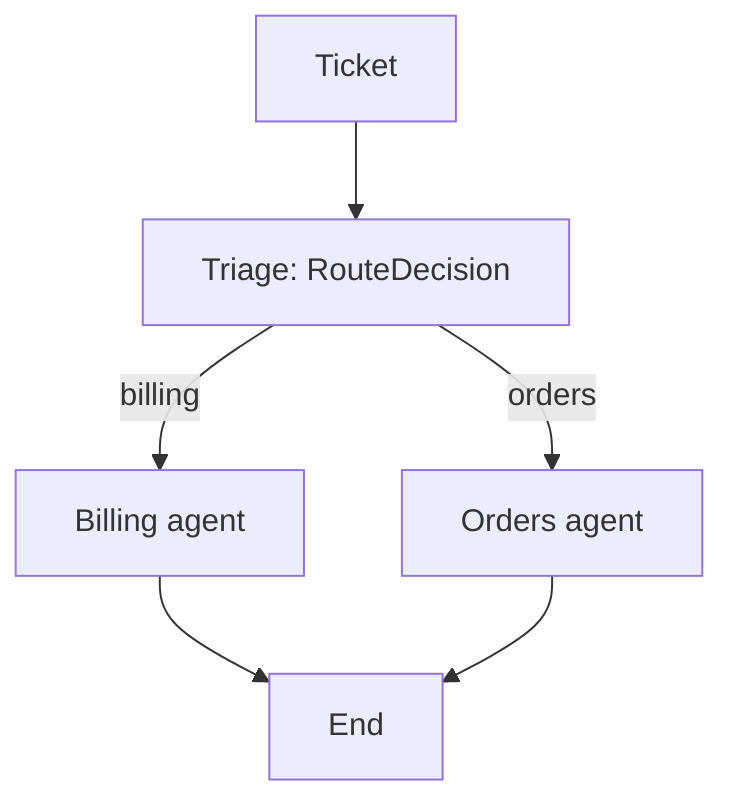

# Stage 2: supervisor and scoped specialists

`build_supervisor_graph()` in `src/merchant_triage/specialists.py` compiles:



## Pydantic decision and actual bindings

`RouteDecision` is a strict Pydantic `BaseModel` with
`route: Literal["billing", "orders"]` and a nonempty `reason`. `Decision`
remains an alias for stage-1 compatibility. Triage returns this model in
`state["decision"]`; the conditional edge uses its validated `.route`.
Here “route decision” means named fields, rather than a scalar `RootModel`.

Each `SpecialistAgent` constructs its own tuple with `bind_tools(role)`.
Only that tuple's schemas are sent to its model. Its executable `ToolSession`
also rejects every unbound name. Triage receives no admin tools. Fixture
access, `reset_store()` and call-log inspection are host/evaluator-only.

| Agent | Read tools | Write tools |
| --- | --- | --- |
| Both | `get_shop` | — |
| Billing | `get_app_subscriptions`, `list_billing_charges` | `cancel_app_subscription`, `issue_billing_credit` |
| Orders | `get_order`, `list_orders`, `list_order_transactions`, `calculate_refund`, `get_delivery_profile` | `create_refund`, `update_shipping_rate`, `recalculate_order_shipping`, `update_order_shipping_address`, `cancel_order`, `add_order_note` |

Effects are tool metadata, model-visible descriptions and trace fields.
`calculate_refund` is read-only; `create_refund` writes a customer-order refund.
All 16 supplied admin functions are accounted for. The supplied mock Python
file is preserved without edits as `src/merchant_triage/mock_admin.py`.
These calls operate an in-memory mock; no real Shopify API is called.

## Fixture mismatch and honest scope

| Source | Maria | Domain | Issue |
| --- | --- | --- | --- |
| Original CSV `SUP-48213` | Maria Sousa | `barro-azul-ceramica.myshopify.com` | Portugal/Europe checkout rates swapped |
| Supplied mock store | Maria Santos | `azulejo-ceramica-lisboa.myshopify.com` | EU Standard EUR 0; domestic EUR 4.90 |

None of the 24 CSV domains exists among the four mock fixtures. The supervisor
can load all 24, but cannot fix their absent stores. It keeps the original
domain, calls `get_shop`, reports missing fixture data and leaves stores
unchanged. No identity remapping or invented fixture is used. CSV expected
fixes/tool names are evaluator-only; absent API names such as
`get_shipping_profile` are not invented as executable tools.

`data/supervisor_demo_tickets.json` contains two explicitly authored fixture
integration cases, separate from the original 24:

- **Maria Santos:** verify the profile and historical order `#1158`, restore
  `rate_eu_standard` from EUR 0 to EUR 14.90 for future checkouts, list all 40
  zero-postage EU Standard orders from 29 Nov through 2 Dec, preserve domestic
  shipping and leave existing orders unchanged. This does not stand in for
  Maria Sousa's different expected fix.
- **Owen Brooks:** read app subscriptions and November invoice lines, credit
  exactly one duplicate USD 19.99 ReviewStream charge, preserve the active app
  subscription and leave customer orders unchanged.

## Per-call evidence

Every ticket starts with `reset_store()`. Execution validates strict argument
schemas and the ticket's store boundary, requires `get_shop` first and requires
write-target IDs to have appeared in prior reads. Each call records arguments,
effect, result, the actual `CALL_LOG`, pre/post store SHA-256 and changed paths.
Independent code compares read results to pre-call data and write results and
effects to post-call data, checking unrelated fields as well. Each fixture demo
also has explicit end-state assertions outside the model (`verify_demo`).

These are simulated integration boundaries, not a complete production payments
policy. Approval thresholds, persistent idempotency, human escalation and
mixed-issue resolution remain later work. A single selected specialist does
not solve both halves of a mixed ticket. Runs stop after 10 model turns or 24
tool calls. Prior successful writes remain visible if a later step errors.

## Commands and workflow

```bash
python -m pytest -q
merchant-triage supervise data/supervisor_demo_tickets.json --output reports/supervisor-smoke.json
merchant-triage supervise data/source/shopify_merchant_tickets.csv \
  --ticket-id SUP-48213 --ticket-id SUP-48197 --output reports/supervisor-original.json
# The graph can also iterate the full original set; its fixtures are missing:
merchant-triage supervise data/source/shopify_merchant_tickets.csv --output reports/supervisor-24.json
```

The CLI prints merchant names, routes/reasons, agents, READ/WRITE calls and
store-check outcomes. JSON includes the full actual results and call log.
Exit codes: `0` all cases passed, `1` includes failed/unavailable cases, `2`
configuration/input error. The mock store is reset after reporting.

The manual **Supervisor mock-store smoke** workflow uses the existing Actions
secret and pinned free model. It requires the two fixture-backed passes and
separately checks that two original tickets report missing stores without a
write. Workflow success does not mean those original expected fixes succeeded.
Offline tests use scripted model replies and do not measure classification.

The triage prompt is `SYSTEM_PROMPT` in `openrouter.py`. The specialist prompt
is `SPECIALIST_PROMPT` in `specialists.py`, formatted with the selected role.
The user content is a JSON object with `trusted_context.shop_domain` and
`merchant_message`. No expected label or fix enters either model's input.
Live evidence will identify the tested source commit and preserve actual output.
